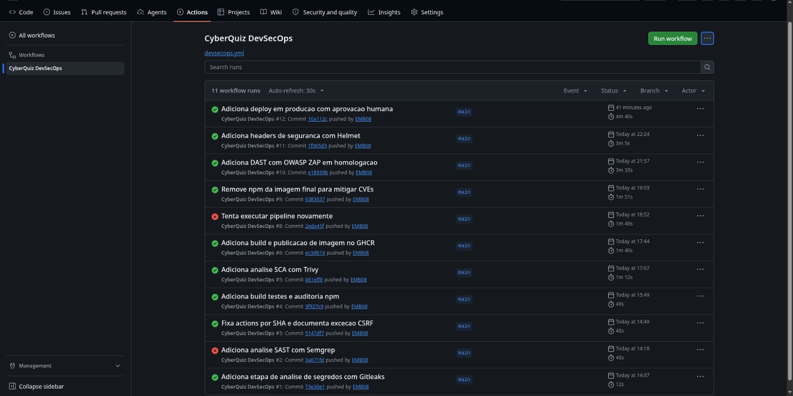
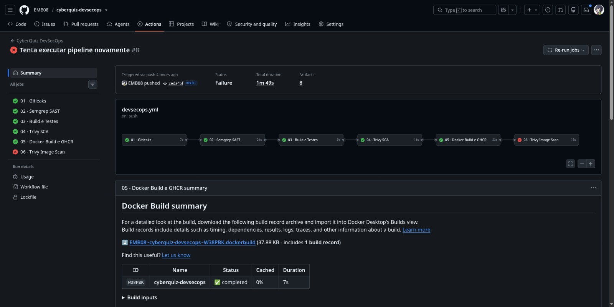
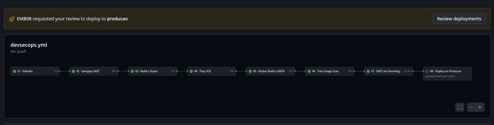
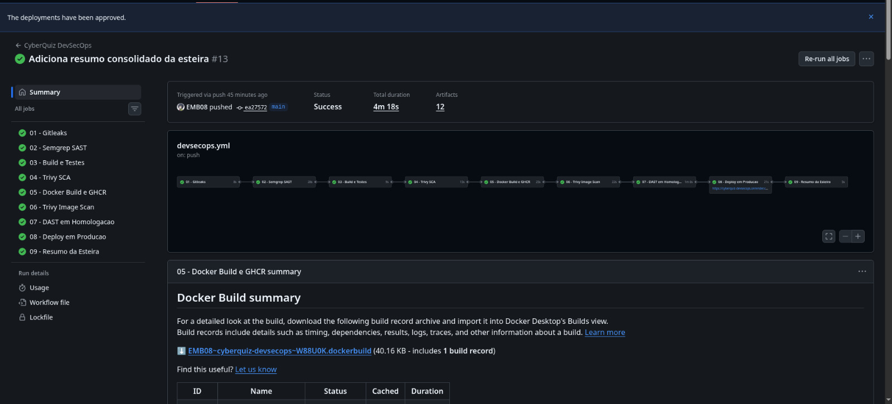
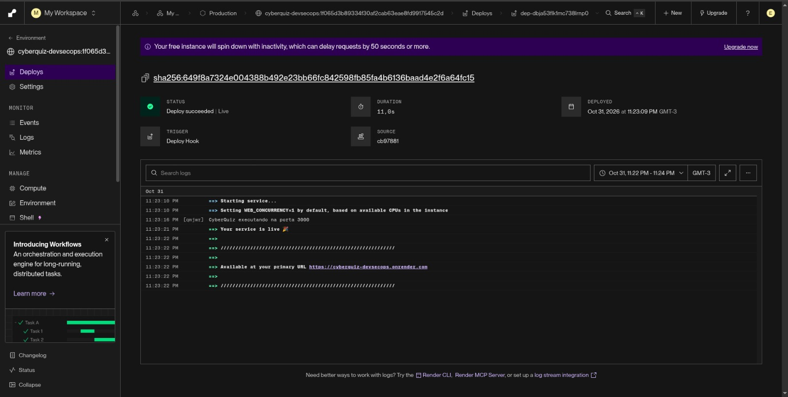

# Pipeline DevSecOps - CyberQuiz

## 1. Objetivo

A pipeline DevSecOps do CyberQuiz automatiza testes, análises de segurança, construção e publicação de imagens Docker e implantação em produção, garantindo rastreabilidade e aplicação de controles de qualidade ao longo do processo.

A automação está definida no arquivo `.github/workflows/devsecops.yml` e utiliza o GitHub Actions.

## 2. Visão geral da esteira

```text
Push / Pull Request / Execução manual
                  |
                  v
       01 - Secrets Scan
             Gitleaks
                  |
                  v
           02 - SAST
             Semgrep
                  |
                  v
       03 - Build e Testes
           npm ci / npm test
                  |
                  v
            04 - SCA
              Trivy
                  |
                  v
       05 - Docker Build
           Docker / GHCR
                  |
                  v
       06 - Image Scan
              Trivy
                  |
                  v
       07 - DAST Staging
            OWASP ZAP
                  |
                  v
       08 - Deploy Produção
        Aprovação humana
        Render + Health Check

       09 - Pipeline Summary
     Consolida os resultados
     mesmo em caso de falha
```

O job 09 depende dos resultados dos oito jobs anteriores e utiliza `if: always()` para executar mesmo quando uma etapa falha ou é ignorada.

## 3. Descrição dos jobs

| Job | Ferramenta | Finalidade | Critério |
|---|---|---|---|
| 01 - Secrets Scan | Gitleaks | Detectar segredos expostos no histórico Git | Bloqueante |
| 02 - SAST | Semgrep | Identificar problemas de segurança no código | Bloqueante |
| 03 - Build e Testes | npm / Node.js | Validar instalação e testes automatizados | Testes bloqueantes; npm audit informativo |
| 04 - SCA | Trivy | Identificar vulnerabilidades e configurações inseguras | Bloqueante conforme severidade configurada |
| 05 - Docker Build | Docker Buildx | Construir e publicar imagem no GHCR | Bloqueante |
| 06 - Image Scan | Trivy | Analisar vulnerabilidades da imagem Docker | Bloqueante para vulnerabilidades HIGH/CRITICAL corrigíveis |
| 07 - DAST | OWASP ZAP | Avaliar a aplicação em execução em homologação | Informativo |
| 08 - Deploy | GitHub Actions / Render | Aprovar e publicar a versão validada | Aprovação humana e verificações obrigatórias |
| 09 - Summary | GitHub Actions | Consolidar o resultado dos oito jobs | Executa mesmo após falhas anteriores |

## 4. Controles de segurança

### Detecção de segredos

O Gitleaks analisa o histórico Git para identificar possíveis credenciais, tokens e outras informações sensíveis expostas no repositório.

### Análise estática

O Semgrep executa regras de segurança sobre o código-fonte e a configuração da aplicação.

Foram identificados alertas relacionados ao uso de referências mutáveis no GitHub Actions e à ausência de middleware CSRF. Os tratamentos e justificativas estão documentados em `docs/observacoes.md`.

### Análise de dependências

O Trivy verifica vulnerabilidades e outros problemas de segurança nos arquivos do projeto. A pipeline aplica critérios de severidade para impedir a continuidade quando encontra problemas bloqueantes.

### Análise da imagem Docker

Após a publicação da imagem no GitHub Container Registry, o Trivy verifica vulnerabilidades na imagem gerada.

A construção utiliza uma imagem de produção reduzida, com dependências necessárias à execução e usuário sem privilégios de root.

### Análise dinâmica

O OWASP ZAP executa uma análise baseline contra a aplicação iniciada no ambiente de homologação do GitHub Actions.

O relatório é preservado para análise posterior. O DAST é informativo, portanto a conclusão do job não significa ausência de alertas.

## 5. Publicação e rastreabilidade

A imagem Docker é construída com Docker Buildx e publicada no GitHub Container Registry (GHCR).

A versão publicada é identificada pelo commit e pelo digest SHA-256, permitindo rastrear qual imagem foi produzida e posteriormente implantada.

O deploy em produção utiliza um serviço hospedado no Render:

https://cyberquiz-devsecops.onrender.com

## 6. Aprovação humana

O job `deploy-prod` utiliza o ambiente protegido `producao` no GitHub Actions.

Antes da implantação, um revisor autorizado precisa aprovar manualmente a execução.

Após a aprovação, a pipeline:

1. Aciona o deploy no Render.
2. Aguarda a conclusão da implantação.
3. Verifica se a imagem implantada corresponde ao digest esperado.
4. Executa o health check da aplicação.
5. Publica um relatório da implantação.

Uma falha nas verificações impede que o job de produção seja considerado bem-sucedido.

## 7. Relatórios e artifacts

Cada etapa relevante gera relatórios disponíveis nos artifacts da execução do GitHub Actions.

Entre eles:

- `relatorio-01-gitleaks`
- `relatorio-02-semgrep`
- `relatorio-03-build`
- `relatorio-04-trivy-sca`
- `relatorio-05-docker-build`
- `relatorio-06-trivy-image`
- `relatorio-07-zap-baseline`
- `relatorio-08-producao`
- `resumo-da-esteira`

O artifact `resumo-da-esteira` contém o arquivo `resumo-esteira.md`, com uma tabela dos resultados das oito etapas principais.

O resumo também é publicado na aba **Summary** do GitHub Actions.

## 8. Evidências de execução

### Pipeline concluída com sucesso

[Execução com nove jobs verdes](https://github.com/EMB08/cyberquiz-devsecops/actions/runs/41334618244)

[Artifact do resumo da esteira](https://github.com/EMB08/cyberquiz-devsecops/actions/runs/41334618244/artifacts/13094676897)

### Exemplo de bloqueio por quality gate

[Execução anterior com bloqueio na análise de imagem](https://github.com/EMB08/cyberquiz-devsecops/actions/runs/41245636912)

A execução bloqueada demonstra que uma vulnerabilidade identificada pelo scanner pode impedir a progressão para as etapas seguintes.

A correção aplicada à imagem Docker permitiu que execuções posteriores fossem concluídas com sucesso.

### Evidências visuais

As capturas abaixo documentam a evolução da pipeline, desde os bloqueios de segurança até a implantação bem-sucedida em produção.

### Histórico de execuções



O histórico registra execuções concluídas com sucesso e execuções bloqueadas durante o desenvolvimento da esteira.

### Quality gate bloqueado



O Trivy identificou vulnerabilidades na imagem Docker e interrompeu a pipeline no job 06, demonstrando o funcionamento do controle bloqueante.

### Aprovação humana



O GitHub Actions exige revisão manual antes da execução do job de produção.

### Pipeline concluída com sucesso



Após as correções, a execução `41334618244` concluiu os nove jobs com sucesso, incluindo deploy e resumo consolidado.

### Deploy no Render



O Render registra o deploy concluído, a execução do serviço e o digest da imagem utilizada.

**Aplicação:** https://cyberquiz-devsecops.onrender.com

## 9. Resultado

A pipeline demonstrou a integração entre práticas de desenvolvimento, testes automatizados, segurança e implantação contínua.

A execução validada concluiu os nove jobs com sucesso, incluindo aprovação humana, verificação da imagem implantada e geração do resumo consolidado.

Os achados de segurança, as correções, os riscos residuais e as lições aprendidas são apresentados em [Observações de Segurança](observacoes.md).

